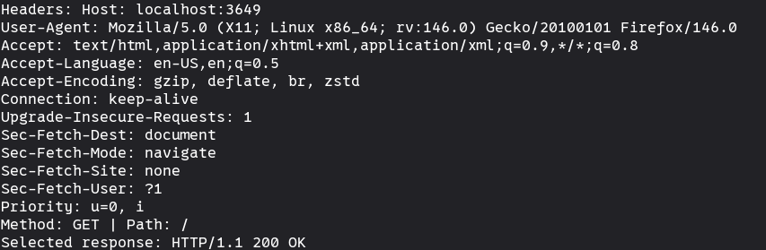

# http-server

A small HTTP/1.1 server written in C from scratch, built to learn how HTTP works on top of raw sockets. It uses only the POSIX sockets API and the C standard library, with no external dependencies.

The socket setup follows Beej's Guide to Network Programming (see References).

## Features

- TCP listener built with `getaddrinfo`, `socket`, `bind`, `listen` and `accept`
- Request line parsing (method, path, version)
- Header parsing and validation
- Valid HTTP responses with status line, headers and `Content-Length`
- Route handling for `/`, `/hello` and static assets
- Custom error pages: `400 Bad Request` and `404 Not Found`
- `405 Method Not Allowed` for unsupported methods
- Path traversal protection
- Test harness for the request parser

## Limitations

- Handles one client at a time (no concurrency yet)
- Every response uses `Connection: close` (no keep-alive)
- No support for request bodies or chunked transfer encoding

## Build

```
make
```

## Run

```
./build/server
```

The server listens on port 3649.

## Tests

The parser tests live in `tests/test_request.c`. They feed valid and malformed requests through the parser and print PASS or FAIL for each case.

## Project layout

```
.
├── assets/          HTML served by the server
│   ├── index.html
│   ├── hello.html
│   ├── 400.html     error page for bad requests
│   └── 404.html     error page for unknown paths
├── src/
│   ├── server.c     socket setup and accept loop
│   ├── request.c/h  request line and header parsing
│   ├── routes.c/h   maps method and path to a handler
│   └── response.c/h builds and sends HTTP responses
├── tests/
│   └── test_request.c
├── Makefile
└── README.md
```

### Screenshots

Home page served in the browser:




## References

- Beej's Guide to Network Programming: https://beej.us/guide/bgnet/
- RFC 9112, HTTP/1.1 message syntax: https://www.rfc-editor.org/rfc/rfc9112
- RFC 9110, HTTP semantics: https://www.rfc-editor.org/rfc/rfc9110
